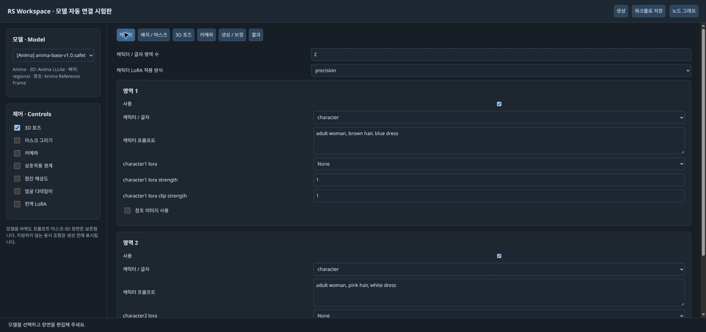
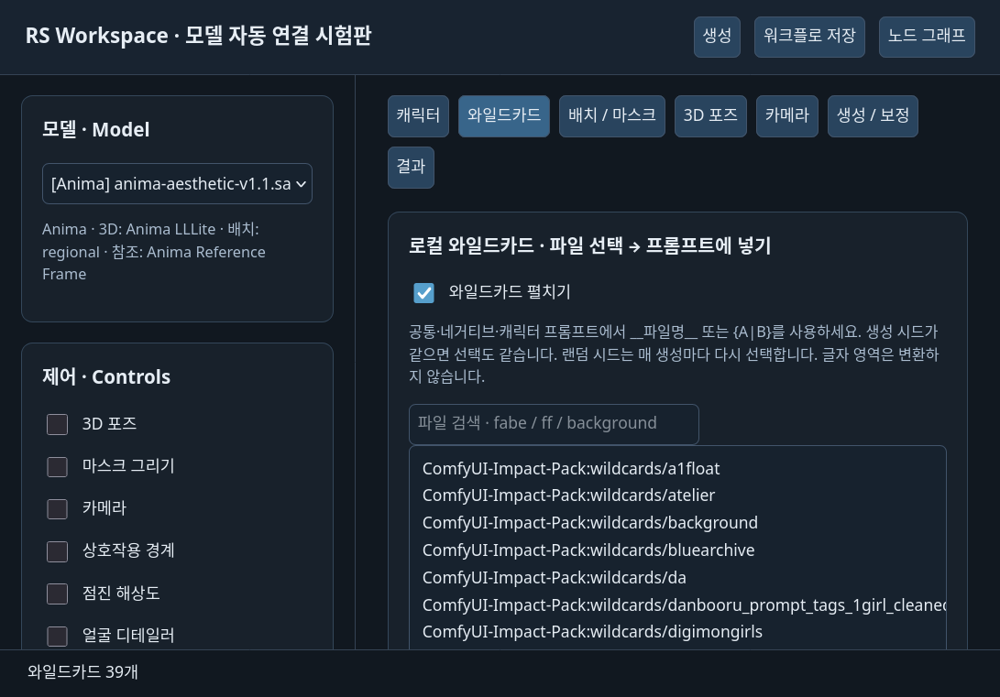
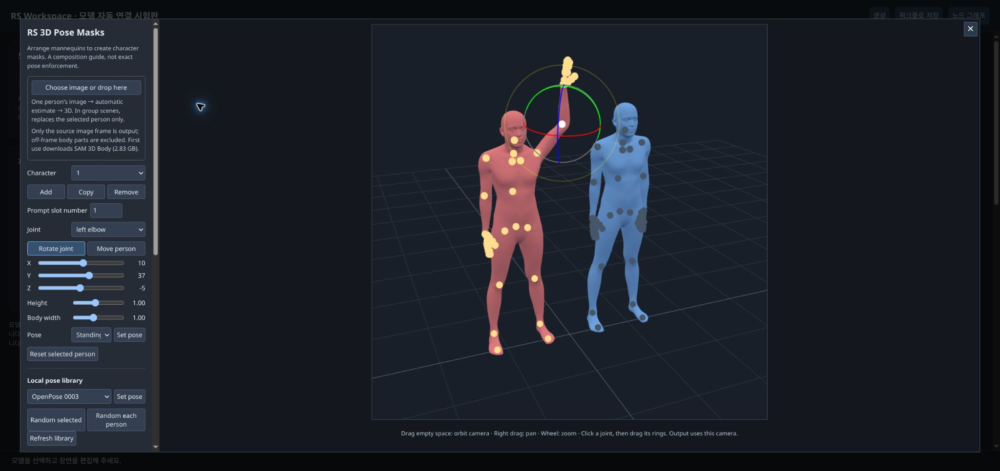

# RS Workspace 앱 사용 가이드

노드 연결을 직접 구성하는 대신, 모델·캐릭터·영역을 화면에서 편집하고 생성하는 앱 화면입니다. 기존 RS 노드를 연결해서 실행하므로 **노드 그래프에서 이어서 수정할 수 있습니다.**

이 문서는 **1.1.0에 포함된 RS Workspace 시험판** 기준입니다. 기존 RS MultiCharacter Sampler 패키지를 업데이트하면 사용할 수 있습니다. 모델별 모든 기능 조합의 생성 품질을 보장하지는 않으며, 지원 경로와 제한은 아래에서 확인할 수 있습니다.

## 1. 열기와 첫 생성

### 설치·업데이트 후 어디서 여나요?

1. **ComfyUI-Manager → Custom Nodes**에서 **RS MultiCharacter Sampler**를 찾아 설치 또는 업데이트합니다. 패키지 ID는 `comfyui-rs-multicharacter-sampler`이고 **1.1.0 이상**이어야 합니다. [Registry 페이지](https://registry.comfy.org/publishers/raspie10032/nodes/comfyui-rs-multicharacter-sampler)에서도 확인할 수 있습니다.
2. Git으로 설치했다면 이 확장 폴더에서 `git pull --ff-only`를 실행합니다. 처음 설치할 때는 `ComfyUI/custom_nodes`에서 아래 명령을 실행하세요. **동일한 확장을 중복 설치하지 마세요.**

   ```sh
   git clone https://github.com/raspie10032/ComfyUI_RS_MultiCharacter_Sampler.git
   ```

3. **ComfyUI 서버를 재시작**합니다. 브라우저 탭만 닫았다 여는 것으로는 Python 기능이 업데이트되지 않습니다.
4. 평소 사용하는 ComfyUI 주소를 엽니다. 로컬 기본 설정은 `http://127.0.0.1:8188/`이며, 다른 포트·원격 주소를 사용한다면 해당 주소로 접속합니다.
5. **Ctrl+Shift+R**로 강력 새로고침합니다. macOS에서는 **Cmd+Shift+R**입니다.
6. **화면 오른쪽 아래 `RS Workspace`** 버튼을 누릅니다. 확장 명령 메뉴가 표시되는 프런트엔드에서는 **Edit → RS Model Workspace (Experimental)**로도 열 수 있습니다.

**별도 앱 설치·별도 서버 실행은 필요 없습니다.** 앱 화면은 현재 ComfyUI 안에서 열리며 기존 RS 노드로 생성합니다. 기본 모델·인코더·VAE 파일은 따로 준비하세요. 앱 화면은 현재 한국어 중심이며 기존 노드 편집기는 설정된 로케일을 사용합니다.



### 처음 한 장 생성하기

1. ComfyUI에서 오른쪽 아래 **RS Workspace**를 누릅니다. 보이지 않으면 설치와 서버 재시작을 확인하고 브라우저를 강력 새로고침합니다.
2. 왼쪽 **모델**에서 설치된 모델을 고릅니다. 필요한 로더·텍스트 인코더·VAE와 모델별 처리 경로가 연결됩니다.
3. **캐릭터**에서 사용할 영역 수를 정하고, 각 번호의 프롬프트를 입력합니다.
4. **배치 / 마스크**에서 번호별 위치를 조절합니다. 처음에는 포인트나 박스로 시작해도 됩니다.
5. **생성 / 보정**에서 공통 장면, 해상도, 시드와 생성값을 확인합니다.
6. 위쪽 **생성**을 누릅니다. 아래 상태줄에서 진행·오류를 확인하고, 완료 후 **결과**에서 이미지를 엽니다.

일반 워크플로에서 앱을 열면 별도의 앱 워크플로 탭을 만듭니다. **노드 그래프**를 누르면 앱이 연결한 실제 노드로 돌아갑니다. 별도의 생성 엔진을 중복 실행하는 방식이 아닙니다.

## 2. 모델 선택과 자동 연결

모델을 고르면 해당 계열의 프리셋과 연결을 사용합니다. 모델 아래 안내에 **3D 경로·영역 배치 방식·참조 지원 상태**가 표시됩니다.

| 모델 계열 | 3D 포즈를 켰을 때 | 기본 영역 경로 |
|---|---|---|
| Anima 2B | 렌더링한 포즈 이미지 + LLLite | 리저널 |
| Anima 2.9B | 3D에서 투영한 영역 마스크. 2B용 어댑터를 적용하지 않음 | 리저널 |
| Krea 2 | 전용 장면 포즈 어댑터 | 리저널 |
| MOSS | 전용 장면 포즈 어댑터 | 네이티브 JSON |
| SDXL·SD1.5·FLUX 계열 | 투영한 영역 마스크. 이 앱에서 전용 포즈 어댑터를 연결하지 않음 | 리저널 |

**3D 마스크만 사용하는 경로와 학습된 포즈 어댑터를 사용하는 경로는 다릅니다.** 영역 마스크는 해당 캐릭터가 들어갈 자리를 유도하며, 관절 자세를 정확히 고정하지 않습니다. SD1.5는 실행 호환 수준이며 고해상도 품질을 기대하기 어렵습니다.

모델별 샘플링·LoRA·포즈 어댑터·디테일러 설정은 따로 기억합니다. 장면·마스크를 다시 그릴 필요 없이 모델을 바꿔볼 수 있습니다. 다른 계열로 처음 전환할 때 캐릭터 LoRA 선택은 초기화하고 전역 LoRA는 끕니다. 다시 돌아오면 그 모델에 저장했던 값을 불러오므로 **생성 전 현재 프롬프트와 설정을 확인**하세요.

현재 모델 목록은 지원 계열의 **safetensors**를 판별합니다. 앱에서 GGUF 로더를 선택하거나, 임의 이름의 텍스트 인코더를 자동으로 찾아 연결하는 기능은 아직 없습니다. 누락된 인코더·VAE는 안내를 보고 준비해야 하며 기본 모델을 자동 다운로드하지는 않습니다.

## 3. 캐릭터·글자·LoRA

**캐릭터 / 글자 영역 수**를 지정하면 해당 번호까지 편집할 수 있습니다. 최대 10개입니다. 수를 줄이거나 **사용**을 끄면 기존 입력은 남겨두고 실행에서 제외합니다. 처리 영역이 많아질수록 품질을 보장하지 못합니다.

각 번호에서 선택하는 것은 다음과 같습니다.

- **캐릭터:** 외모·의상·역할을 프롬프트로 입력합니다. 공통 배경이나 전체 인원은 공통 프롬프트에 적고, 번호별 특징은 여기서 나눕니다.
- **글자:** 그 영역에 넣을 문자열을 입력합니다. 위치는 **박스**로 정하세요. 모델마다 글자 구현 능력이 다르며 철자·배치의 정확성을 보장하지 않습니다.
- **캐릭터 LoRA:** 그 번호에 쓸 LoRA와 모델·텍스트 인코더 강도를 선택합니다. 캐릭터 프롬프트·위치와 **같은 번호**가 연결됩니다.

**일반 적용**은 지원되는 경로에서 계산을 공유해 가볍게 처리합니다. **정밀 적용**은 서로 다른 LoRA 설정의 모델 계산을 나누므로 느릴 수 있습니다. 일반 적용을 지원하지 않는 조합은 기존 처리 경로에서 정밀 방식으로 처리하고 이유를 표시합니다. 정밀을 선택한다고 결과가 항상 더 좋아지는 것은 아닙니다.

전체 화풍을 바꾸려면 왼쪽 **전역 LoRA**를 켜고 **생성 / 보정 → 전역 LoRA**에서 선택합니다. 캐릭터별 LoRA와 구분해 사용하세요. 모델 계열에 맞는 LoRA가 필요합니다.

## 4. 와일드카드: 파일 선택부터 다시 뽑기까지

**와일드카드** 탭에서 기존 TXT 파일을 검색하고, 삽입할 프롬프트를 선택한 뒤 **선택한 파일 넣기**를 누릅니다. 로컬에 있는 `fabe`·`ff`도 그대로 사용합니다.



직접 입력할 수도 있습니다.

```text
공통: 2girls, __backgrounds__, {walking together|having tea}, autumn
캐릭터 1: __fabe__, long wool coat, blue scarf
캐릭터 2: __ff__, long wool coat, white scarf
```

각 TXT는 **한 줄이 한 후보**입니다. 빈 줄과 `#`로 시작하는 주석 줄은 제외합니다. 한 후보에 쉼표가 있어도 그 줄 전체를 선택합니다. 파일은 다음 폴더에서 찾습니다.

| 폴더 | 용도 |
|---|---|
| `ComfyUI/user/wildcards` | 직접 추가할 파일. 사용자 디렉터리를 바꿨다면 그 디렉터리의 `wildcards` |
| `ComfyUI/wildcards` | ComfyUI 공통 파일 |
| `custom_nodes/확장/wildcards` 또는 `custom_wildcards` | 설치된 확장의 기존 와일드카드 |

폴더 이름이 중첩되면 `__poses/arms__`처럼 사용합니다. 다른 확장에 같은 파일명이 있으면 짧은 이름이 모호해지므로 **목록에서 전체 이름을 삽입**하세요. 예를 들어 현재 로컬의 `fabe`는 `__ComfyUI-Impact-Pack:wildcards/fabe__`로 지정할 수 있습니다. 파일을 추가한 뒤에는 **파일 목록 새로고침**을 누릅니다.

지원하는 문법은 `__파일명__`, `{A|B}`, 후보 안의 중첩 와일드카드, `__poses/*__`처럼 파일명에 `*`를 쓰는 선택입니다. 다른 확장의 가중 추첨·여러 후보 동시 추첨·YAML 문법 전체를 그대로 구현한 것은 아닙니다. 우선 TXT와 위 문법을 사용하세요.

**현재 시드로 미리보기**는 생성하지 않고 선택 결과만 보여줍니다. 프롬프트를 수정했다면 다시 미리보기를 누릅니다.

- **고정 시드:** 같은 파일 내용·템플릿·시드라면 같은 후보를 선택합니다.
- **랜덤·증가 시드:** **생성 / 보정 → 세부 설정**의 기존 시드 제어(`control_after_generate`)를 사용합니다. 생성 요청의 시드로 와일드카드를 펼칩니다. 랜덤 생성 시 미리보기의 시드와 실제 생성 시드가 다를 수 있습니다.
- **캐릭터 수 감소·비활성화:** 실행하지 않는 슬롯은 펼치지 않습니다. 숨긴 슬롯의 없는 파일 때문에 생성이 실패하지 않습니다.
- **글자 영역:** 문자열을 그대로 보존합니다. `MENU {A|B}`를 입력했다고 임의로 바꾸지 않습니다.
- **펼치기 OFF:** 템플릿을 입력 그대로 전달합니다. 자동 추첨이 필요할 때 켜세요.

공통·네거티브·각 캐릭터는 독립된 추첨 흐름을 사용합니다. 같은 시드에서 배경을 바꿨다는 이유만으로 다른 캐릭터 후보까지 바뀌지 않습니다. 같은 파일을 두 캐릭터에 쓰면 같은 인물이 중복 선택될 수 있으며, 자동 중복 제외 기능은 없습니다.

파일 누락·이름 중복·빈 파일·순환 참조는 **생성 전에 파일명을 포함한 오류**로 안내합니다. 앱의 최근 생성 요청 패널과 결과 PNG에 실제 펼친 내용을 기록합니다. 현재는 **생성 버튼 한 번에 이미지 한 요청**이며 장수를 지정해 자동 반복하는 기능은 아직 없습니다.

## 5. 포인트·박스·마스크 편집

**배치 / 마스크**에서 상단의 **편집할 번호**를 먼저 선택합니다. 프롬프트·LoRA·참조·영역은 같은 번호끼리 사용합니다.

- **포인트:** 해당 캐릭터가 들어갈 중심 위치를 지정합니다.
- **박스:** 캐릭터나 글자가 차지할 사각 영역을 지정합니다. 드래그로 옮기고 모서리로 크기를 조절합니다.
- **마스크:** 왼쪽 **마스크 그리기**를 켜고, 아래 드로잉 편집기에서 번호별로 그립니다. 참조 이미지를 밑에 두고 실루엣을 따라 그릴 수 있습니다.

마스크 편집기에서 붓·지우개·이동·크기 조절을 사용합니다. 그린 뒤 위치 편집기의 같은 번호를 선택해 옮기거나 확대·축소할 수 있습니다. 마스크 크기와 위치를 모델의 확정된 인체 윤곽으로 해석하지 마세요. 그림을 그릴 조건 영역입니다.

**캔버스 밖으로 나간 마스크만 잘라 사용**합니다. 생성 인물의 머리나 팔다리를 마스크 경계대로 잘라내는 기능이 아닙니다. 마스크를 켜고 아무것도 그리지 않으면 생성 전에 안내하므로, 먼저 그리거나 기능을 끕니다.

3D와 그린 마스크를 함께 사용하면 파이프에는 **3D → 그린 마스크 → 번호별 위치 설정** 순으로 들어갑니다. 같은 번호의 그린 마스크·명시적 위치가 뒤에서 덮어쓸 수 있으므로, 우선 3D만으로 배치를 확인한 뒤 원하는 번호에 보정 영역을 추가하세요.

**MOSS 네이티브는 마스크를 외접 사각형으로 바꿉니다.** 불규칙한 실루엣을 그대로 네이티브 JSON에 전달하는 것은 아닙니다.

## 6. 3D 포즈·이미지에서 자세 가져오기·랜덤 포즈

왼쪽 **3D 포즈**를 켜고 **3D 포즈 → 3D 편집기 열기**를 누릅니다. WebGL2를 지원하는 브라우저가 필요합니다.



1. 인물을 추가하고 **프롬프트 슬롯 번호**를 캐릭터 번호와 맞춥니다.
2. 인물이나 관절을 선택합니다. **관절 회전**으로 링을 드래그하거나, **인물 이동**으로 배치합니다.
3. 키·몸 너비·기본 자세를 조절합니다.
4. 빈 곳 드래그로 시점을 회전하고 오른쪽 드래그로 이동, 휠로 확대·축소합니다. 현재 카메라가 출력에 사용됩니다.
5. **노드에 적용**을 누르고 창을 닫습니다. 편집창에서 조작한 것만으로 끝내지 말고 적용까지 하세요.

**이미지 → 3D**는 이미지 한 장이나 인물 한 명의 크롭을 넣으면 자세를 추정합니다. 여러 인물이 있는 장면에서는 선택한 인물만 교체합니다. 최초 사용 시 SAM 3D Body 모델을 다운로드할 수 있습니다. 화면에 보이는 신체만 출력하며 화면 밖 하체를 굳이 만들어 영역에 넣지 않습니다. 깊이와 가려진 관절은 추정값이므로 필요하면 마우스로 고칩니다.

**로컬 포즈 라이브러리**에서는 저장한 포즈를 고르거나 **선택 인물 랜덤 / 각 인물 랜덤**을 누릅니다. 라이브러리 파일이 있어야 하며, TXT 와일드카드와는 별개의 기능입니다. 여기서 랜덤을 누르는 것은 그 시점에 포즈를 선택하는 동작입니다. 생성할 때마다 자동으로 바뀌는 기능과 혼동하지 마세요.

**전체 실루엣**은 가려진 부분까지 영역을 만들고, **보이는 실루엣**은 앞 인물에 가린 부분을 제외합니다. 겹침을 허용하는 구도에서는 차이를 확인하세요. 장면 저장·불러오기는 3D 장면만 다루며 전체 생성 워크플로 저장과 다릅니다.

**포즈 적용은 3D 노드 하나에서 끝납니다.** `auto`에서는 샘플러가 실제 모델을 보고 아니마 2B·Krea2·MOSS 어댑터를 내부에서 준비합니다. 별도 MODEL·VAE·패치 로더를 연결하지 않습니다. 강도·시작·종료도 3D 탭에서 고릅니다. `masks_only` 또는 강도 0은 마스크만 사용하고 어댑터를 받지 않습니다. 아니마 2.9B 등 대응 어댑터가 없는 모델은 마스크만 쓰며 결과에 이유를 표시합니다. 자세 어댑터와 이미지 참조의 동시 사용, Krea2/MOSS 자세 어댑터의 점진 해상도 사용은 지원하지 않습니다.

## 7. 카메라·상호작용

왼쪽 **카메라**를 켜고 **카메라** 탭에서 시점·거리·기울기를 조절합니다. 카메라용 프롬프트와 영역 변환이 캐릭터 파이프에 들어갑니다. 원형 시점과 상하 높이는 각각 중심에서 마우스가 향하는 쪽으로 조절합니다.

거리·기울기와 원근 변환은 조건 영역에 반영하지만, 2D 영역만으로 가려진 인체와 배경의 실제 3D 구조를 복원하는 기능은 아닙니다. **3D 편집기의 카메라**는 장면을 투영하는 카메라이고, **카메라 컨트롤**은 그 뒤의 시점 유도·영역 변환입니다. 처음에는 하나씩 켜서 차이를 확인하세요.

왼쪽 **상호작용 경계**를 켜면 카메라 탭 아래에서 프리셋을 선택합니다. Anima·SDXL의 겹치지 않는 캐릭터 영역을 더 오래 분리하는 제어입니다. 겹친 부분은 기존 스케줄을 유지합니다. `baseline`에서 시작하고 `delay3`, `delay6` 또는 `custom`으로 조절하세요. 팔·손의 정확한 접촉을 보장하는 포즈 제어는 아닙니다.

## 8. 캐릭터별 이미지 참조

**캐릭터 → 참조 이미지 사용**을 켜고 각 번호의 이미지를 고르거나 업로드합니다. 참조 해상도는 긴 변 기준이며, 강도와 Anima 방식을 조절할 수 있습니다.

이미지는 같은 번호의 포인트·박스·마스크를 따라갑니다. 큰 특징을 유도하는 실험 기능이며, LoRA와 같은 수준의 재현을 보장하지 않습니다. 얼굴 디테일러는 이미지 참조를 재적용하지 않습니다.

Anima는 `reference_frame`부터 사용하세요. 2.9B는 2B용 `role_kv` 가중치를 사용할 수 없습니다. Krea·FLUX 등의 참조는 기존 모델별 경로를 사용합니다. 기존 FLUX.1 체크포인트는 Kontext 참조 경로가 필요하므로, 이 앱이 연결하지 못하는 경우 실행을 막습니다.

참조를 켜면 리저널 배치로 연결됩니다. MOSS 네이티브 JSON과 참조를 동시에 쓰는 설정으로 해석하지 마세요. SD 계열·MOSS의 기존 실험 참조도 현재 기능 목록에 남아 있으나 품질 추천의 의미는 아닙니다.

## 9. 샘플링·점진 해상도·얼굴 디테일러

**생성 / 보정**에서 공통·네거티브 프롬프트, 최종 가로·세로, 시드, 스텝, CFG, 샘플러와 스케줄러를 조절합니다. 모델 선택 시 넣는 값은 시작점입니다. Anima 시작값은 30스텝·CFG 4·Euler ancestral / SGM uniform입니다.

왼쪽 **점진 해상도**를 켜면 작은 해상도에서 시작해 최종 크기로 확대하며 샘플링합니다. **시작 배율 0.5–1.0** 범위에서 조절합니다. 더 큰 결과를 약간 빠르게 얻는 대신 디테일이 줄어들 수 있고, 시작 배율이 낮을수록 품질을 보장하기 어렵습니다. 기존 멀티캐릭터 영역 제어는 유지합니다.

**얼굴 디테일러**를 켜면 생성 결과에 얼굴 보정을 연결합니다. 모델·공통 프롬프트·캐릭터 파이프·LoRA를 이어받고, 세부 보정 해상도·디노이즈·스텝은 따로 정할 수 있습니다. 다인 생성에서는 WD 태거를 자동 연결해 얼굴과 캐릭터 프롬프트를 매칭합니다. 한 명일 때는 WD 매칭 사용 여부를 선택할 수 있습니다.

감지 모델은 SEGM/BBOX/SAM 통합 로더에서 고릅니다. 얼굴 SEGM이 있으면 불필요한 SAM 처리를 추가하지 않습니다. 모델·태거의 최초 사용에는 다운로드와 선택 기능의 의존성 설치가 필요할 수 있습니다. 검출이 없거나 매칭이 모호하면 보정 보고서의 사유를 확인하세요.

## 10. 결과·저장·같은 조건으로 다시 실행

**결과** 탭에는 최근 저장 결과가 표시됩니다. 이미지를 누르면 원본을 엽니다. 저장 접두사는 **생성 / 보정 → 저장**에서 바꿉니다.

**워크플로 저장**은 편집 가능한 JSON을 내려받습니다. 생성 결과는 기존 SaveImage로 저장하므로 메타데이터를 끄지 않은 기본 설정에서는 **PNG에 워크플로와 실행 요청이 포함**됩니다. 공유할 때 원본 PNG를 전달해야 합니다. JPG로 변환하거나 메타데이터를 지우는 업로드 서비스를 거치면 워크플로가 사라질 수 있습니다.

다시 열 때는 ComfyUI의 일반 파일 불러오기나 PNG 드래그로 읽은 뒤 **RS Workspace**를 누릅니다. 앱 상태가 포함된 워크플로라면 모델·장면·영역을 이어서 편집할 수 있습니다.

와일드카드 결과 PNG에는 **실제로 펼친 노드 값 + 원래 템플릿**이 함께 저장됩니다. 일반 그래프에서 재실행할 때는 펼친 프롬프트를 사용하므로 원래 TXT가 필요하지 않습니다. 앱에서 다시 랜덤으로 뽑으려면 TXT 파일이 있어야 합니다. PNG를 읽은 뒤 그래프에서 직접 고친 프롬프트는 자동 템플릿 복원이 덮어쓰지 않습니다.

시드가 같아도 모델·LoRA·파일 후보·생성 설정을 바꾸면 동일한 이미지 재현을 보장할 수 없습니다. 최근 요청 패널은 선택 내용을 보여주는 기록이며, 다음 랜덤 생성 결과의 보장은 아닙니다.

## 11. 막혔을 때

| 표시·증상 | 확인할 것 |
|---|---|
| RS Workspace 버튼이 없음 | 1.1.0 이상인지 확인 → 서버 재시작 → Ctrl+Shift+R. ComfyUI 확장 설정에서 RS.MultiCharacter.Workspace 활성화 여부와 중복 설치 확인 |
| 앱을 열 때 Model inventory HTTP 오류 | 현재 ComfyUI 주소를 쓰는지 확인하고 서버 재시작. 역방향 프록시를 쓴다면 앱 API 경로도 함께 전달되는지 확인 |
| 기존 프런트엔드에서 빈 탭 안내 | 새 빈 워크플로 탭을 만든 다음 RS Workspace를 열기. 기존 작업은 먼저 저장 |
| 생성 버튼이 비활성화 | 모델 아래의 누락 파일·금지 조합 안내 확인 |
| 마스크가 비어 있음 | 번호를 선택해 그리거나 마스크 그리기 OFF |
| 3D 편집기가 열리지 않음 | WebGL2·브라우저 GPU 가속 확인. 저장된 장면으로 생성은 별개 |
| Krea·MOSS에서 기능을 함께 켜면 차단 | 전용 포즈 어댑터 + 이미지 참조 또는 점진 해상도 동시 사용은 현재 미지원 |
| 와일드카드를 못 찾음 | 파일 검색·목록 새로고침·전체 이름 사용 |
| 같은 캐릭터만 나옴 | 시드 고정 여부와 후보 파일 내용 확인. 한 후보만 있는 파일은 시드를 바꿔도 같음 |
| 일반 노드에서 되던 기능의 설정이 안 보임 | 노드 그래프로 돌아가 확인. 앱은 전체 그래프 기능을 모두 노출한 정식 대체품이 아닌 시험판 |

## 12. 예제 파일 받기

[1.1.0 릴리스](https://github.com/raspie10032/ComfyUI_RS_MultiCharacter_Sampler/releases/tag/v1.1.0)의 **RS-Workspace-Wildcard-Example.zip**을 받으세요. PNG와 예제 배경 TXT·설명서가 들어 있습니다. PNG를 ComfyUI로 드래그하면 실제 노드 연결과 앱 설정을 불러옵니다. 예제 모델·태거·감지 파일은 포함하지 않으니 설치된 파일로 바꾸세요. TXT 없이 일반 그래프로 다시 실행할 수 있고, 앱에서 다시 추첨하려면 ZIP의 TXT를 안내된 사용자 폴더에 넣습니다.

## 13. 이번 와일드카드 검증 범위

2026-10-31 Firefox 앱 화면에서 로컬 파일 39개 목록, 검색·삽입·고정 시드 미리보기·없는 파일 오류를 확인했습니다. 앱 생성 버튼으로 **Anima 1024×1024 / 30스텝 / CFG 4 / Euler ancestral / SGM uniform**, 두 캐릭터의 선택지와 공통 배경 TXT를 펼쳐 생성했습니다. 카메라와 얼굴 디테일러를 켰고 **얼굴 2개 검출·2개 보정**을 확인했습니다.

서버 요청·보정 보고서·실제 저장 PNG를 대조해 펼친 공통·개별 프롬프트가 카메라와 디테일러에 전달되고, PNG에 원래 템플릿과 함께 저장된 것을 검증했습니다. 요청 전체는 약 **36.98초**였으며 모델 로딩·보정을 포함하는 단일 연결 시험이라 성능 비교 수치는 아닙니다.

회귀검사는 필드별 추첨 독립성, 중첩·누락·중복 이름·빈 파일·순환 참조, 숨긴 슬롯과 글자 영역 제외, 직렬화 실패 시 템플릿 복원과 PNG 복원 도우미를 포함합니다. 이후 Firefox의 **File → Open**에서 실제 생성 PNG를 새 워크플로로 불러오고 앱을 다시 열어, Anima 선택·캐릭터 두 개·원래 선택지 템플릿과 최근에 펼친 프롬프트가 복원되는 것을 확인했습니다.
