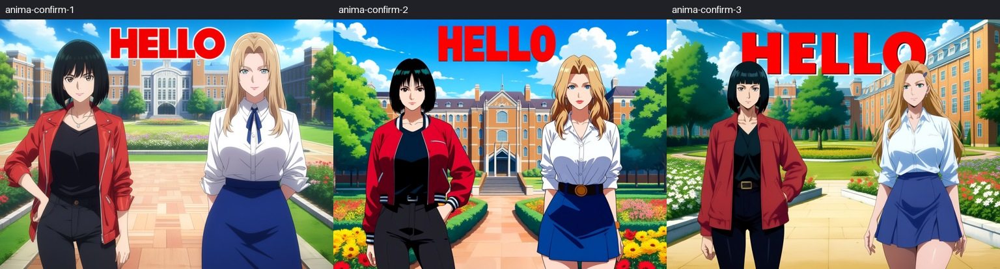
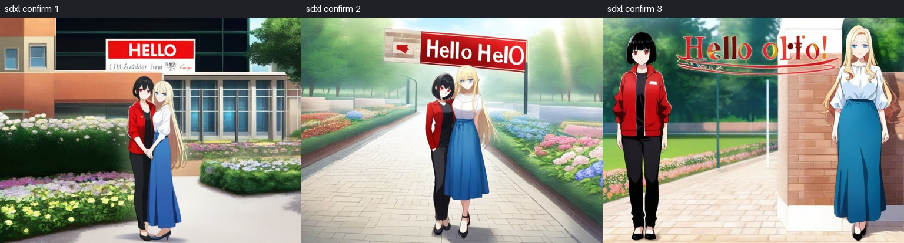
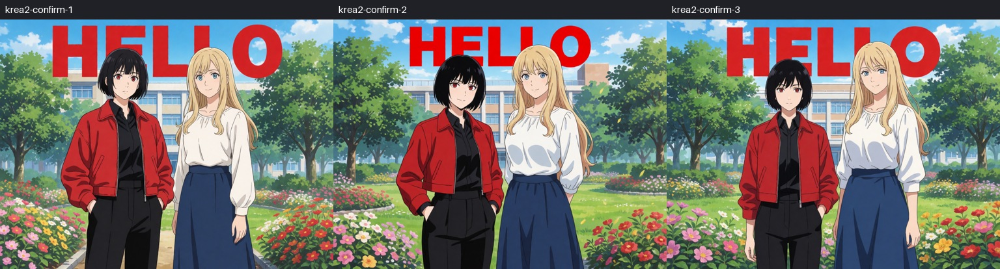
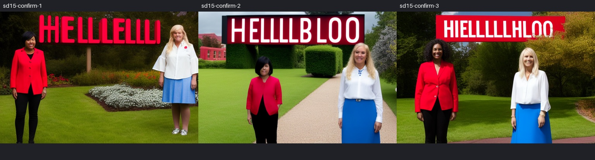

# Mixed layouts: model-specific starting settings

Two point regions describe two people; a third, rectangular text region requests `HELLO`. The shared scene is a university garden. These examples were tuned with real generation on **2026-10-17**. They are starting settings for the named checkpoints, not a quality guarantee for every derivative or prompt.

The original mixed Anima example lost the campus and clipped the title. Raising early common conditioning restored the shared scene. Subsequent caption and framing adjustments retained two distinct people, the campus and an unclipped `HELLO` in the reference seed and two additional randomly selected seeds. Reducing boundaries indiscriminately produced repeated lettering, so weaker separation was not adopted for Anima.

## Load a tuned example

Open a workflow below, select your installed model files and run it. The adjacent `*-api.json` file has the same generation inputs and contains no validation-only nodes. All workflows use `mixed` layout and `regional` sampling, with **three regions but two people**.

| Model / workflow | Initial common | Initial character | Initial separation | Sampling |
|---|---:|---:|---:|---|
| [Anima base v1.0](../examples/epsilon/anima-mixed.json) | 0.60 | 1.70 | 0.90 | 30 steps, CFG 4, Euler ancestral / SGM uniform |
| [Illustrious XL v1.0](../examples/epsilon/sdxl-mixed.json) | 0.15 | 1.50 | 0.90 | 30 steps, CFG 5.5, Euler ancestral / normal |
| [Krea 2 Turbo FP8](../examples/epsilon/krea2-mixed.json) | 0.60 | 1.20 | 0.35 | 8 steps, CFG 1, Euler / simple |
| [SD1.5 base, experimental](../examples/epsilon/sd15-mixed.json) | 0.20 | 1.70 | 0.90 | 30 steps, CFG 7, Euler ancestral / normal |

`common_after_step3_boost=0.1`, `boundary_hold_steps=3`, `boundary_decrement=0.2`, and `region_feather=0.04` are retained in these examples. The table shows initial values, not a constant weight throughout generation. Anima, SDXL and Krea 2 use 1024×768; SD1.5 uses 768×512. Existing workflows and the sampler's defaults are unchanged. The previously tested MOSS examples remain available in the same folder.

## What changed and what did not work

- **Anima:** give the common scene meaningful early influence. Describe both people as standing on the same garden path; suppress white backgrounds, character sheets, collages and panels in the negative prompt. The text box is centered at `(0.50, 0.14)`, size `(0.65, 0.20)`, leaving more headroom. This changes framing and captions as well as strength; the final improvement cannot be attributed to one number alone.
- **SDXL / Illustrious:** use tag-style character descriptions and a lower common weight. Raising common strength as in Anima caused one person to disappear in an earlier comparison. All three final seeds retain two people and the campus/garden. The reference spells `HELLO` but adds unwanted small lettering; the other seeds repeat the word or add malformed letters. Shortening the text style or adding negative terms for extra lettering did not consistently remove this problem; those variants were not adopted.
- **Krea 2 Turbo:** the original moderately strong common conditioning and weaker boundaries already gave a shared background and readable text. Stronger character/separation settings with rewritten prompts introduced a detached extra portrait in one trial. The selected example retains the original Krea settings and captions.
- **SD1.5:** the acceptance criterion is deliberately limited to distinct people and a visible result in the requested text area. All three final seeds show two distinguishable people (dark hair/red clothing and blonde hair/white clothing), a garden, and lettering above them. Exact spelling fails in all three. This meets the compatibility criterion; photorealism, natural anatomy, exact text and consistent identities are not quality targets for this example. Earlier alternatives omitted the title or introduced an extra person.

The common prompt also names the desired title and total person count. The comparison therefore demonstrates the **combined prompt and regional workflow**, not that the text box alone caused the placement. The box is a conditioning region; visible letters can extend outside it. No font renderer, post-generation text overlay or image compositing was used.

## Validation and reproduction

The tuning sequence used 16 fixed-prompt strength comparisons, 12 model-specific scene/prompt comparisons, seven context/boundary variants and two SDXL text-cleanup variants. Within each controlled strength comparison, the checkpoint, seed, layout and prompt were held fixed. Later prompt changes are separate comparisons.

The selected workflows are checked with seeds **346751**, **1226307043**, and **867403938**. The latter two were newly selected at random and recorded before generation. The reference seed is included for replay, not counted as an independent random sample. Three samples per model cannot establish a general success rate.

All **49 submitted cases** completed successfully: 37 exploratory cases and 12 final confirmations. Visual assessment of the final confirmations is separate from execution success:

| Model | Two visually distinguishable people | Shared campus/garden | Title region | Observed limits |
|---|---|---|---|---|
| Anima | 3/3 | 3/3 | Readable, unclipped `HELLO` in 3/3 | Still a fairly static title illustration; box outlines are not enforced |
| Illustrious XL | 3/3 | 3/3 | Lettering in 3/3; clean requested word is not consistent | Extra small text, repeated words or malformed letters |
| Krea 2 Turbo | 3/3 | 3/3 | Readable `HELLO` in 3/3 | Hair can overlap the title; letters extend beyond the box |
| SD1.5 | 3/3 | 3/3 | Lettering in 3/3; exact `HELLO` in 0/3 | Compatibility criterion met; quality and spelling are not established |

Removing the audit-only output node and replaying the reference seed produces identical decoded RGB pixels for Anima, Krea 2 and SD1.5. Illustrious retains the same visible composition but is **not pixel-identical** (mean absolute RGB difference 1.178869 on the 0–255 scale, maximum 100). The cause of this numerical difference was not isolated; this follow-up does not claim bit-exact SDXL replay. All final confirmation samplers ran, rather than returning a cached sampler output.

Live workflow schema checks verify widget order, values, links, installed model choices and exclusion of the validation capture node. Visual findings and final replay results are recorded in the [evidence record](mixed-layout-evidence.json). See also the [original Epsilon implementation validation](epsilon-validation.md) for attention, metadata and old-point compatibility tests. This follow-up changes example settings and documentation; it does not introduce a new attention algorithm or a hidden per-model override.
