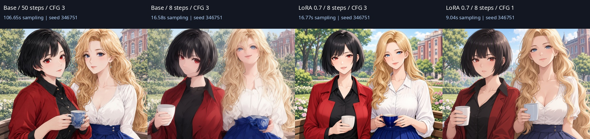
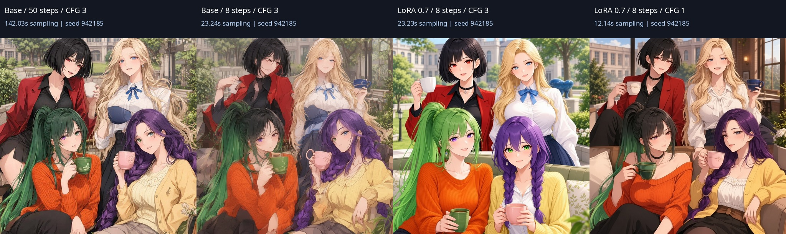

# MOSS-Image SFT 8-step LoRA

## Load a workflow

| Layout | CFG 3: clearer attributes in this trial | CFG 1: fewer model evaluations |
| --- | --- | --- |
| Two characters, 1024×768 | [Workflow](../examples/moss-8step/two-cfg3.json) · [API](../examples/moss-8step/two-cfg3-api.json) | [Workflow](../examples/moss-8step/two-cfg1.json) · [API](../examples/moss-8step/two-cfg1-api.json) |
| Four characters, XY, 1024×1024 | [Workflow](../examples/moss-8step/four-xy-cfg3.json) · [API](../examples/moss-8step/four-xy-cfg3-api.json) | [Workflow](../examples/moss-8step/four-xy-cfg1.json) · [API](../examples/moss-8step/four-xy-cfg1-api.json) |

These are ordinary ComfyUI workflows using the existing character/sampler nodes and
the built-in `LoraLoaderModelOnly`. No measurement or private custom node is needed.
The sampler implementation and its default settings are unchanged in 0.1.4.

1. Install a ComfyUI core with native MOSS support and its `requirements.txt` in
   your ComfyUI Python environment. Restart. `Load CLIP` must offer `moss_image`.
   Installing this extension alone cannot supply that architecture.
2. Prepare the MOSS-Image SFT diffusion model, Qwen3.5 9B text encoder and Flux2
   VAE. See [base-model sources and terms](krea-moss-validation.md).
3. Download the tested [LoRA file at the pinned revision](https://huggingface.co/lodestones/MOSS-Image-SFT-8-steps-dmd/resolve/f95df83b5e90ae91ea412434b3f9b7f1c8c6314f/lora_latest.safetensors)
   into `ComfyUI/models/loras/`. Refresh the model list and select its actual name
   in **Load LoRA (Model Only)**. The saved examples use
   `moss/lodestones_8step_latest_f95df83.safetensors`; you can use this subfolder
   and filename, or select your own filename after loading the workflow.
4. Connect `Load Diffusion Model → Load LoRA (Model Only) → RS MultiCharacter
   Sampler`. Connect CLIP, VAE and the character pipe as usual. Start with LoRA
   strength **0.7**, **8 steps**, **Euler / simple**, and the chosen CFG.
5. The example seeds are fixed for comparison. Select `randomize` for new seeds.
   Common and character text are English natural-language descriptions. The
   examples use the ordinary ComfyUI LoRA loader and sampling path; they do not
   implement the model card's deprecated separate data-space sampler.

## Exact assets and recorded environment

The LoRA is published by [lodestones](https://huggingface.co/lodestones/MOSS-Image-SFT-8-steps-dmd),
separately from OpenMOSS's base model. Its model card labels the adapter Apache-2.0;
the base model and other assets retain their own terms. We distribute workflows
and comparison images, not model weights.

| Item | Recorded value |
| --- | --- |
| LoRA | `lora_latest.safetensors`, strength 0.7 |
| Revision | `f95df83b5e90ae91ea412434b3f9b7f1c8c6314f` |
| SHA-256 | `be82ab2bef78194651815bb6de443cec67553e01c14559f2ad365449445f0452` |
| File size | 1,189,176,800 bytes |
| Diffusion model | `moss_image_sft_bf16.safetensors` |
| Text encoder | `qwen3.5_9b_int8_convrot.safetensors`, CLIP type `moss_image` |
| VAE | `flux2-vae.safetensors` |
| Original comparison extension | 0.1.3, `c3e334b06710467e2d2f2f7de872dcf67bd56c38` |
| Original comparison ComfyUI | 0.41.0, `a639f187a9f6abfecbda9673034f2045148b6d85` |
| Hardware / runtime | RTX 5060 Ti 16GB, Python 3.12.14, PyTorch 2.14.0+cu130, dynamic VRAM and previews disabled |
| Seeds | Two: 346751; four XY: 942185 |

`latest` is a mutable filename. The pinned revision and hash identify the actual
weights used here; a future upload may behave differently.

## Real generation results — 2026-10-17

Eight comparison requests and one clean workflow replay completed successfully.
Within each scene, prompt, seed, coordinates and regional controls were held
constant; only steps, CFG and LoRA presence changed. The values below measure
the sampling interval with CUDA synchronization, excluding model loading, text
encoding, VAE decoding and saving. Each condition ran once, alongside other GPU
work. [Measurements and prompt IDs](../examples/moss-8step/measurements.json).

| Condition | Two characters | Four XY | Model evaluations |
| --- | ---: | ---: | ---: |
| Base, 50 steps, CFG 3 | 106.65 s | 142.03 s | 100 |
| Base, 8 steps, CFG 3 | 16.58 s | 23.24 s | 16 |
| LoRA 0.7, 8 steps, CFG 3 | 16.77 s | 23.23 s | 16 |
| LoRA 0.7, 8 steps, CFG 1 | 9.04 s | 12.14 s | 8 |

Each comparison below is ordered: base 50 steps, base 8 steps, LoRA CFG 3,
LoRA CFG 1.

The requested counts survived in these eight images. Compared with base 8-step
generation, LoRA CFG 3 produced clearer faces and colors. In the four-character
case, the blonde character's blue cup was missing. CFG 1 retained four cups but
mixed black into the green-haired character's fringe and weakened eye colors.
These observations cover two fixed scenes, not a general success rate or a
ranking across seeds, styles and actions.

The original instrumented runs recorded 252 LoRA patches across 168 model keys,
a changed runtime weight sample, and restored routing forwards. Replaying the
two-character CFG 3 case without instrumentation produced identical pixels.
Those are the original 0.1.3 comparison results, not a new 0.1.4 benchmark. See
[0.1.4 release validation](release-0.1.4.md) for the subsequent checks.

CFG 3 means 8 sampler steps but 16 model evaluations. CFG 1 matches the adapter
author's eight-evaluation, no-CFG condition. The faster 50-to-8-step comparison
comes from fewer steps; applying this LoRA did not make the same 8 steps faster.

This LoRA trial did not cover detailing, img2img, other samplers, other LoRA
strengths, or large seed sweeps. Earlier base-MOSS detailer execution evidence
does not establish the 8-step adapter's detailer quality. No NovelAI request or
Anlas was used.
