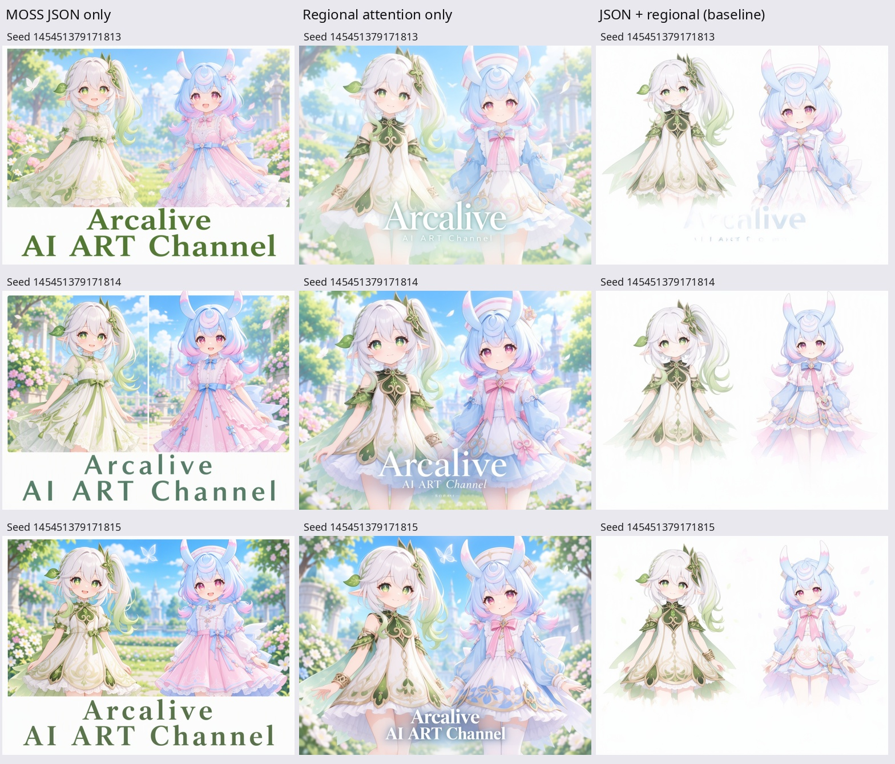
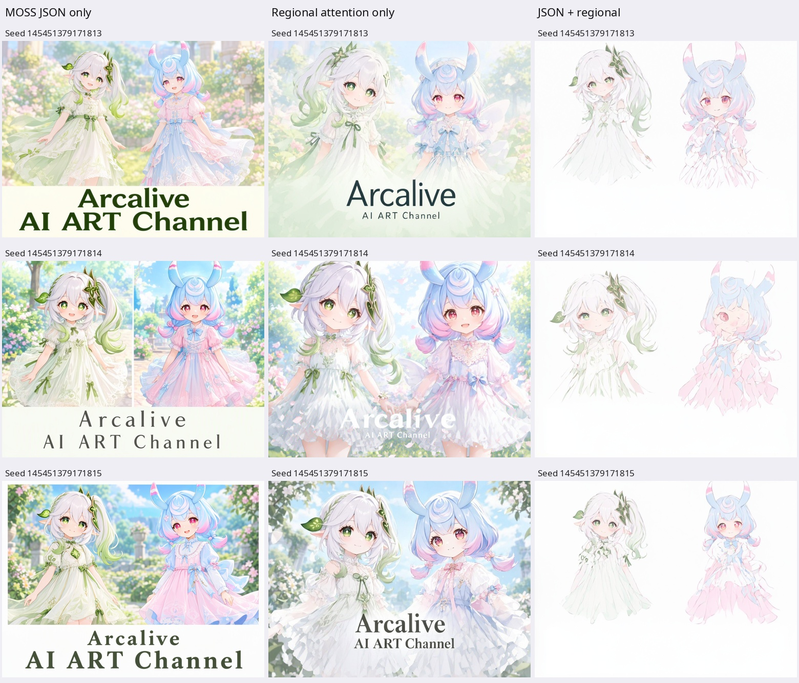

# MOSS community usage report: native JSON and regional attention

Experiment date: 2026-10-20. Implementation: `25003d1f6361ad7e6049055888eb4b51735705b0`,
based on ComfyUI_RS_MultiCharacter_Sampler 0.2.3. ComfyUI:
`5cc4b870094c89090db54bd8d12649dcaf89f2ba`. GPU: RTX 4070 Ti SUPER.

Thank you to the MOSS team for releasing the model and documenting its layout
format. This is a small community experiment, shared in case the results are
useful to your layout-control work.

## What was compared

1. `moss_native`: encode the native JSON as one positive condition; no external
   regional attention routing.
2. `regional`: encode the plain scene caption and individual character/text
   captions separately; apply our external regional attention routing.
3. `moss_hybrid`: encode exactly the same JSON as (1) as the common condition,
   then add separately encoded regional captions and the routing from (2).

The external implementation isolates the captions in text refinement, routes
image queries to the common and corresponding regional captions, and changes
the common-caption weight, regional value gain and spatial separation during
sampling. MOSS caption rotary positions are tail-aligned independently. The
negative branch keeps native attention. See [joint_engine.py](../../joint_engine.py)
and [the experimental mode integration](../../nodes.py).

This is a comparison of these complete implementations. JSON versus regional
also changes the prompt representation, so it does not isolate attention as the
only causal variable. Hybrid changes routing and adds captions relative to native.

## Settings

| Setting | Value |
|---|---|
| Diffusion model | MOSS Image SFT BF16, `moss_image_sft_bf16.safetensors` |
| Text encoder | Qwen3.5 9B INT8, `qwen3.5_9b_int8_convrot.safetensors`, `moss_image` type |
| VAE | `flux2-vae.safetensors` |
| Resolution | 1024 × 768 |
| Sampler / scheduler | Euler / simple |
| Seeds | 145451379171813, 145451379171814, 145451379171815 |
| Scene | Nahida left, Sigewinne right, layered chiffon dresses, flower garden |
| Text | `Arcalive` followed by `AI ART Channel` on a second line |
| Negative prompt | Empty |
| Character LoRAs | None |

Two batches were generated, each with three modes × three seeds:

- **4 steps, CFG 1.0**: global [akhaliq 4-step v2 LoRA](https://huggingface.co/akhaliq/MOSS-Image-SFT-4-steps/blob/7258a71810f5b2a879c61621e21c0b709f599e73/moss_image_sft_4step_v2.0.safetensors)
  at strength 1.0, locally named `moss/akhaliq_4step_v2_7258a71.safetensors`.
- **50 steps, CFG 3.0**: no LoRA; the execution audit confirmed zero patched keys.

Step count and CFG also differ between batches; this is not an isolated
measurement of the acceleration LoRA's effect.

The regional settings in both batches were: feather 0.04, initial common prior
0.6, common-after-step-3 boost 0.1, initial character gain 1.2, initial spatial
separation 0.35, boundary hold 3 steps, boundary decrement 0.2.

Boxes below are normalized center-x, center-y, width, height:

| Region | Center x | Center y | Width | Height |
|---|---:|---:|---:|---:|
| Nahida | 0.25 | 0.39 | 0.46 | 0.70 |
| Sigewinne | 0.75 | 0.39 | 0.46 | 0.70 |
| Text | 0.50 | 0.855 | 0.88 | 0.23 |

The literal JSON supplied to the text encoder is saved as `native-layout.json`
in each batch directory, including the converted absolute, centered yxyx boxes.
The JSON generator orders object items before the text item; regional pipe
slot 1 is text, slot 2 Nahida, and slot 3 Sigewinne.

## Observations

Columns are native JSON, regional attention, and hybrid. Rows use the three
seeds in the order above.

### Four steps with the acceleration LoRA



### Fifty steps without LoRAs



In this small sample, native JSON tended to compose a distinct title area.
Regional-only tended to integrate lettering into the illustration, with varying
size and contrast. Both retained two distinguishable characters and garden
content, though prompt adherence and typography varied.

Our hybrid repeatedly produced pale images with weakened or missing backgrounds
and lettering. The same pattern appeared without the acceleration LoRA. Three
additional first-seed 4-step explorations reduced boundary separation, regional
gain, or several controls together; none clearly recovered both standalone
results. Those follow-ups are exploratory and are not included in these two
matched nine-image grids.

**This does not demonstrate an improvement from hybrid control, a MOSS bug,
or fundamental incompatibility between native layout and regional attention.**
Possible interactions involving duplicated descriptions, attention allocation
and altered JSON-token interactions remain hypotheses. We have not implemented
routing that understands the semantic spans inside the JSON.

No text-recognition accuracy or general success rate is inferred from three
seeds and one scene. These results concern SFT, not a test of MOSS Image Base.

## Evidence and reproduction

The 18 original PNGs are provided unchanged, with generation metadata. They do
not contain embedded ComfyUI workflow graphs. [manifest.json](manifest.json)
records original SHA256 hashes and routing call counts. Native-only recorded
zero routing calls; regional/hybrid each recorded 168 joint calls at 4 steps
and 2,100 at 50 steps. The implementation increments both cross/self counters
once per joint-attention interception; these are not separate module totals.

The six `*.api.json` files contain the exact sampling inputs and connections
from the first seed, with temporary audit/capture nodes removed and their
model pass-through rewired. This removal affects measurement instrumentation,
not sampling settings. They are ComfyUI **API prompts**, not UI workflow JSONs.
Full scene, character and text prompts are in each file.

To reproduce, use a separate ComfyUI installation with this experimental source
commit (or this branch), the tested ComfyUI commit and matching model files.
See [base-model sources and setup](../krea-moss-validation.md). Adapt only model
filenames to your installation. Each batch has native, regional and hybrid API
graphs; set node `3`'s `seed` to each listed seed. For example, using Python with
`requests` and a running local server:

```python
import json
from pathlib import Path
import requests

graph = json.loads(Path("50step/moss_hybrid.api.json").read_text())
graph["3"]["inputs"]["seed"] = 145451379171813
response = requests.post("http://127.0.0.1:8188/prompt", json={"prompt": graph}, timeout=30)
response.raise_for_status()
print(response.json())  # Retain prompt_id and inspect /history/<prompt_id>.
```

The ordinary 0.2.3 release does not expose `moss_hybrid`; use the experimental
source for that mode. Hardware/backend differences can change generated pixels.
This public bundle publishes existing results; no additional GPU generation was
performed while preparing it.

## Question for the MOSS team

If you have any thoughts on combining external regional attention with the
native layout representation, we would be grateful to hear them. In particular,
would preserving joint interactions for the entire JSON, or routing only the
relevant JSON item token spans, be a more appropriate direction?

Thank you again for making this work available. We hope these examples are
helpful, and we are happy to clarify the implementation if useful.
