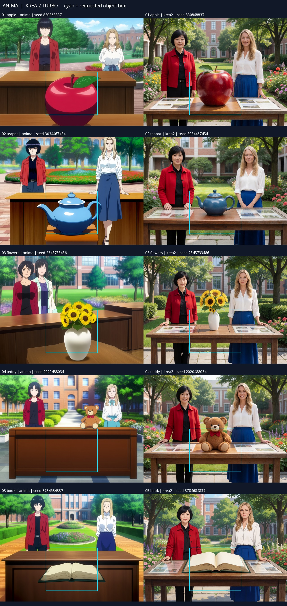
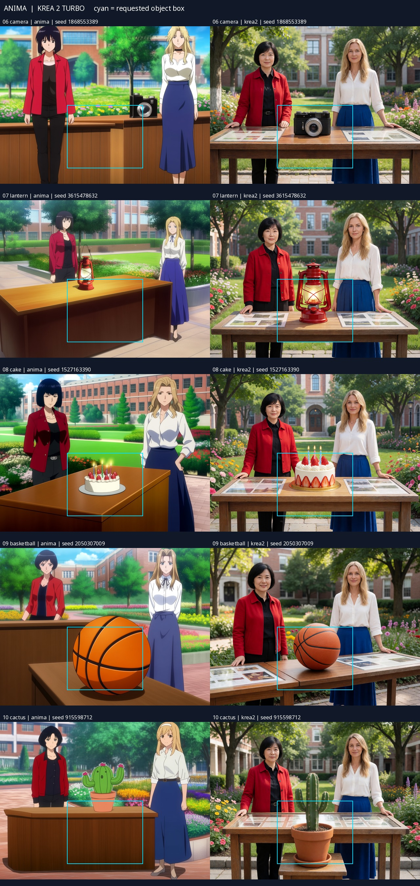

# Two people plus an object — Epsilon trial

The existing **Anima — mixed** and **Krea 2 Turbo** presets were used for ten
objects each: apple, teapot, flower vase, teddy bear, open book, camera, lantern,
birthday cake, basketball and cactus. These are starting settings, not a promise
that an object will fit its rectangle.

## Setup and reproduction

Load a [normal workflow](../examples/epsilon/objects) and select the installed
model, text encoder and VAE. Each workflow has a matching `-api.json` file.
Use **three regions** with `layout_mode=mixed` and `layout_method=regional`:

- Slots 1–2: `character` + `point`, at `(0.22, 0.43)` and `(0.78, 0.43)`.
- Slot 3: `character` + `box`, containing an object description, centered at
  `(0.50, 0.70)`, width `0.36`, height `0.40`.
- Common scene: two adult women behind a table in a university garden; the
  object is also named in the common prompt.

| Model / preset | Steps / CFG | Sampler / scheduler | Initial common / character / separation |
|---|---|---|---|
| Anima Base v1.0 / Anima — mixed | 30 / 4 | Euler ancestral / SGM uniform | 0.60 / 1.70 / 0.90 |
| Krea 2 Turbo FP8 / Krea 2 Turbo | 8 / 1 | Euler / simple | 0.60 / 1.20 / 0.35 |

Both used 1024×768, feather 0.04, common increment 0.1, boundary hold 3 and
boundary decrement 0.2. No LoRA, detailer or postprocessing was used. Anima used
the recorded common negative; Krea used an empty negative and CFG 1. One fresh
random seed was selected for each object and shared across models. The same seed
number does not imply equivalent noise or composition across architectures.

**Objects currently use generic character slots.** This produces three entries
in the character pipe even though only two people are requested. These object
entries are not automatically excluded from face matching. The supplied examples
end at the sampler and do not run the detailer. Literal `text` slots have separate
semantics and are excluded from matching.

## Observations

| Observation | Anima | Krea 2 Turbo |
|---|---:|---:|
| Completed generations | 10/10 | 10/10 |
| Exactly two people | 10/10 | 10/10 |
| Distinct requested hair/clothes | 9/10 | 10/10 |
| Recognizable requested object | 10/10 | 10/10 |
| Object center inside box, visual estimate | 6/10 | 9/10 |
| Center close enough to boundary to leave undecided | 0/10 | 1/10 |
| Whole object inside box, visual estimate | 1/10 | 1/10 |
| Coherent shared table scene, visual assessment | 4/10 | 9/10 |

These are human readings of one image per object/model, not segmentation/IoU
measurements or general success rates. Object bounds include accessories such as
leaves, flowers, handles and plates. The Krea flower-vase center was borderline.
Recognizability does not require every color, candle count or fine detail to match.

Krea usually connected the object and people into one scene, but mostly produced
photographic images despite the anime-style instruction. Anima sometimes created
a separate foreground table, floating object, or displaced characters. Its flower
vase image lost one character's blonde hair. The `A close view of ...` object
caption, and `large` in the apple caption, may have encouraged oversized props.
There is no box-disabled or moved-box control, so the trial does not isolate the
effect of the box from the prompt or preset.

All 20 results, including weak compositions, appear below. Cyan rectangles mark
the requested bounds; these JPEG contact sheets are for inspection, not metadata
restoration.

## Evidence and export scope

The trial ran on 2026-10-17 at extension commit
`3ed20f129817c0037b8d250af68ada12c529dddd`, ComfyUI
`5cc4b870094c89090db54bd8d12649dcaf89f2ba`. Twenty distinct execution records
completed successfully without sampler cache reuse. Saved PNG prompts, regional
geometry and generation settings matched submitted inputs. The execution audit
reported mixed routing and box slot 3. No NovelAI requests or Anlas were used.

The [evidence manifest](object-layout-evidence.json) records every seed, prompt ID,
original image/RGB/API hashes, routing summary and visual assessment. Original
PNG/API hashes identify the retained local trial artifacts. Portable API exports
remove only the terminal `RSValidationCapture` logging node; their hashes are
recorded separately as `published_api_sha256`. Normal workflows contain only
standard loaders and this extension's prompt/sampler nodes. Their input values
were compared with the executed requests, including widget ordering. Exported
workflows were not run for another 20 generations.

## 한국어

**Anima — 혼합 배치 / Krea 2 Turbo** 프리셋을 그대로 사용한 2인+물체
10종 시험입니다. 영역 수는 3개, 1·2번은 좌표, 3번은 `character` + `box`로
물체를 적습니다. 20장 모두 두 사람과 알아볼 수 있는 물체가 나왔지만,
물체 전체가 상자 안에 들어간 것은 모델마다 1장뿐입니다. 상자는 문장이
작용하는 영역이며 정확한 외곽 제한은 아닙니다. Krea는 장면 연결이 더
자연스러웠지만 대부분 실사풍이었습니다. 이 예제의 물체 슬롯은 디테일러
후보에서 자동 제외되지 않으므로 생성 예제로 사용하세요.

## 日本語

**Anima — 混合配置 / Krea 2 Turbo** の既存プリセットを使った、人物2人と
物体10種類の試験です。領域数は3、1・2番は座標、3番は `character` +
`box` にして物体を記述します。20枚すべてに人物2人と識別できる物体が
現れましたが、物体全体が矩形内に収まったのは各モデル1枚です。矩形は
文章が作用する領域であり、正確な輪郭を固定しません。Kreaは場面の
つながりが比較的自然でしたが、多くは写真風でした。この物体枠は顔
ディテイラーの候補から自動除外されないため、生成用サンプルとして
利用してください。
