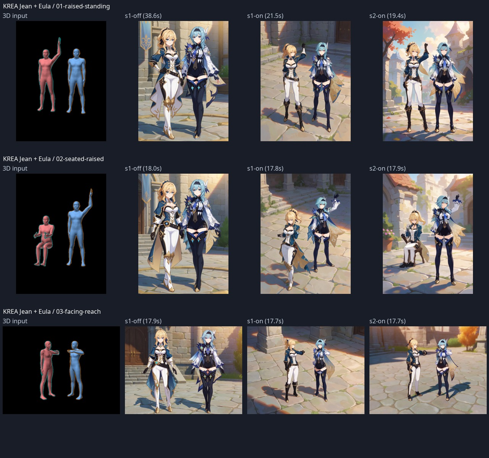
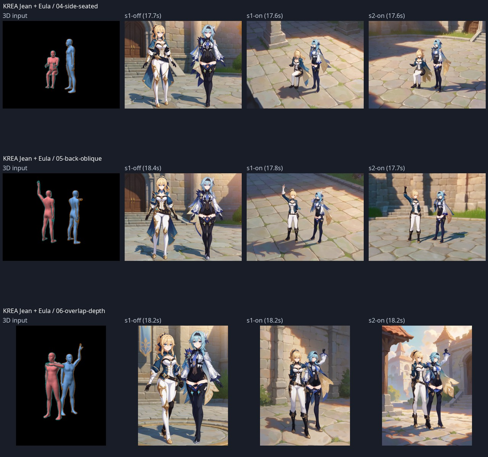
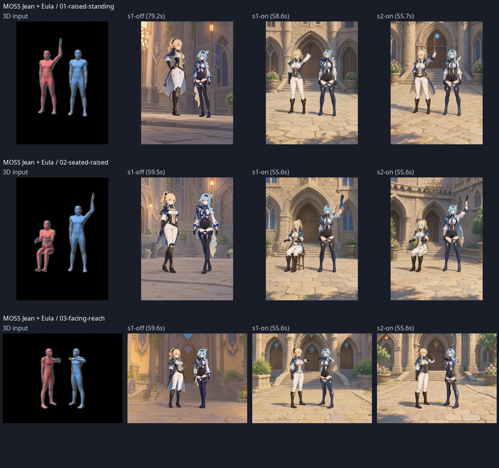
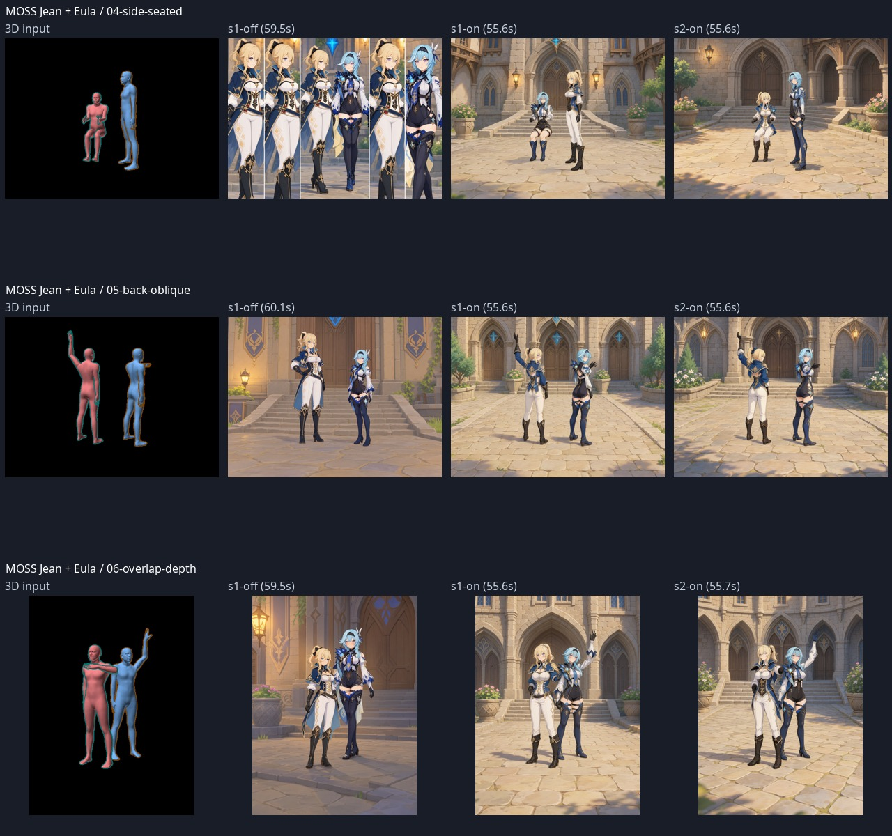

# Krea 2 and MOSS: diverse two-character pose audit

Date: 2026-10-30 (Asia/Seoul). Implementation under test: `ec93d97`.

## Purpose and scope

Verify whether trained pose guidance still changes the intended character's
pose when combined with our character regions. Examples use Jean and Eula from
Genshin Impact, in an anime illustration style, as requested. This audit replaces
the earlier realistic-example batch; those images are not counted here.

All **36 executions completed successfully**, with request/history/PNG metadata
and hashes verified for all 36. Execution success is not a pose-quality score.
All 36 generated images and six input renders were visually inspected.

## Design

Two models × six scenes × (seed 1 OFF, seed 1 ON, seed 2 ON) = 36 images.
Seeds: `421030` and `8517329641052783`. There are 12 matched OFF/ON pairs;
the second seed has ON results only, so it is not a second matched control.

The six scenes are one raised arm, sitting plus the other person's raised arm,
facing/reaching, side-view sitting, back-oblique standing, and front/back overlap.
Portrait scenes use 768×1024 and landscape scenes use 1024×768. Resolution and
scene stay fixed within each OFF/ON comparison. The camera and framing differ
between scenes, and image framing may still drift from the pose input.

| Setting | Krea 2 Turbo | MOSS SFT |
| --- | --- | --- |
| Layout | `regional` | native layout JSON |
| Pose input | OpenPose map from our 3D scene | person-color and depth maps from our 3D scene |
| Steps / CFG | 10 / 1 | 50 / 4 |
| Sampler / scheduler | Euler ancestral / SGM uniform | Euler ancestral / SGM uniform |
| Pose strength | 1 | 1 |
| Application interval | 0–1 | 0–0.5 |

Both models receive the same common prompt describing two anime women, their
names, clothing, and a Mondstadt courtyard. Individual captions identify Jean
and Eula and their appearance. **No raised-arm, sitting, reaching, or other
action instructions were added to the text.** No style or character LoRA was
used; the trained pose-control LoRA itself is part of the adapter.

MOSS ON uses `auto`, confirmed to resolve to `moss_native`; OFF explicitly uses
`moss_native` so disabling the adapter does not also change layout methods.
MOSS converts character masks to enclosing JSON rectangles, while color/depth
guidance remains active. Krea retains regional silhouette masks. Consequently,
this is not a MOSS regional-route validation or a controlled ranking of models.

## Visual observations

| Scene | Krea 2 | MOSS native |
| --- | --- | --- |
| Jean raises one arm, Eula stands | Both ON seeds raise Jean's arm; elbow angle differs | Both ON seeds raise Jean's arm; finer arm angle differs |
| Jean sits, Eula raises one arm | Both ON seeds assign the two actions as requested; support is unclear in seed 1 and a chair appears in seed 2 | Both ON seeds assign the actions as requested and generate a chair |
| Facing and reaching | Jean turns and reaches; Eula's matching reach/contact is incomplete | Arm gestures change, but mutual reach and hand contact are not reproduced |
| Side-view sitting | Sitting/standing distinction survives, but bodies tend to face front | ON seed 1 swaps character/pose roles; seed 2 restores Jean sitting. OFF contains multiple duplicated people |
| Back-oblique standing | Raised arm survives; back-facing body orientation does not | Both ON seeds turn bodies backward and raise Jean's arm; faces turn back and hands remain approximate |
| Front/back overlap | Two characters remain distinguishable; Eula raises an arm, but Jean's reach/contact and depth are inaccurate | Two characters remain distinguishable; Eula raises an arm, but Jean's reach/contact and depth are inaccurate |

The ON results show useful coarse pose response alongside character separation.
They do **not** establish reliable interaction contact, limb angles, left/right
anatomical accuracy, side/back orientation across models, or role assignment.
The MOSS role swap is a concrete remaining failure even when only two people
are present. A duplicated OFF result also shows why generation completion and
person count alone are inadequate quality criteria.

Columns in each comparison: **3D input / seed 1 OFF / seed 1 ON / seed 2 ON**.

## Execution time and evidence

Krea elapsed execution time: **17.581–38.591 seconds**, median **17.880 s**.
MOSS: **55.555–79.234 seconds**, median **55.636 s**.
These are complete ComfyUI execution times with model-load and cache effects,
not pure sampling times, adapter overhead, or a fair speed ranking.

The complete local evidence is in
`/var/home/raspie/AI/rs-pose-integration-20261030/genshin-diverse-audit/`:

- `manifest.json`: model, scene, resolution, seed, adapter state and request file.
- `*.api.json` and `*.history.json`: exact requests and actual execution receipts.
- `*.scene.json`, `*-render.png`, `*-openpose.png`, `*-color.png`, `*-depth.png`:
  scene sources and input maps.
- `results.json`, `receipt-verification.json`, `verify_receipts.py`: timings,
  hashes, metadata and matched-control checks; final result verified 36/36.
- `krea-visual-review.json`, `moss-visual-review.json`: manual observations.
- `index.html`: all images and 3D inputs; `regions.html`: actual conditioning
  regions overlaid on the output (Krea masks; MOSS native enclosing boxes).

The full-resolution raw batch remains local; the repository contains these
comparison sheets and this report. No automatic joint-error measurement or
population success-rate claim is made. Only two characters and two ON seeds
were tested. Complex contact, additional people, and style/character LoRA
combinations remain unverified by this batch. Earlier MOSS style-LoRA failures
are not resolved by these results.

## Supported direction

Continue with Krea regional + trained pose guidance and MOSS native JSON +
trained color/depth guidance as their respective supported experimental paths.
Present them as coarse pose controls, with explicit warnings about interaction,
orientation and character/pose assignment. This audit adds evidence; it does
not justify claiming exact pose enforcement or eliminating the experimental label.
