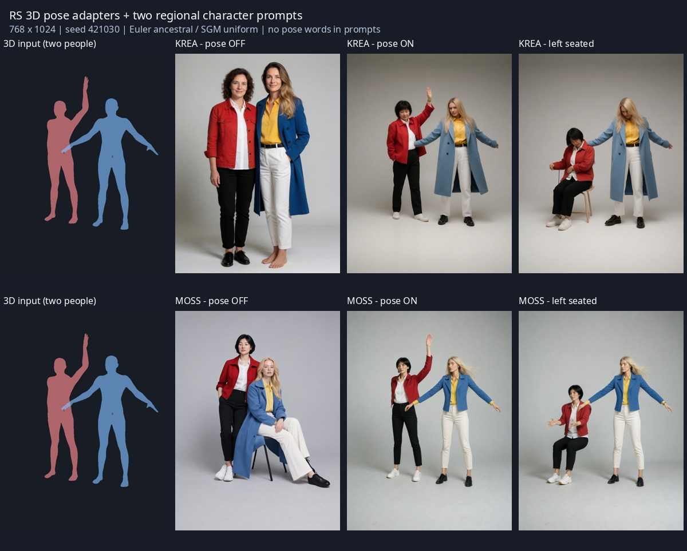

# Krea2 Turbo / MOSS 3D pose integration — 2026-10-30

The prior standalone adapter experiments are now connected to the RS 3D scene and standard RS multi-character sampler. This adds trained pose conditioning alongside numbered character masks; it does not establish precise pose reconstruction or per-character pose adapters.

## Source and runtime

- ComfyUI `5cc4b87`, Python 3.12 / PyTorch on Linux, RTX 4070 Ti SUPER. Test instance port 8193, distinct from the user's resident 8188 instance.
- Krea2 Turbo FP8 scaled; Qwen3-VL 4B FP8 scaled; Qwen Image VAE. Pose weights: `thedeoxen/Krea-2-pose-controlnet`, revision and SHA256 pinned in `reference_assets.json`.
- MOSS Image SFT BF16; Qwen3.5 9B INT8 converted-rotary encoder; Flux2 VAE. Color/depth weights: `darask0/MOSS-Image-color-depth-control`, pinned in the same catalog.
- Krea2 isolated reference K/V implementation adapted from Ostris Edit `7756566160c4a1b24bb1bd9f0ff3ced1a83d7547` (MIT). Upstream license retained. References and terms: [third-party notices](../THIRD_PARTY_NOTICES.md).

## Controlled generation

Two adult women in a light-gray studio. Character 1: short black hair, red jacket/white shirt/black trousers/white sneakers. Character 2: long blonde hair, blue coat/yellow shirt/white trousers/black shoes. No style or character LoRA, image reference, pose words or seated instructions. Both the numbered prompt/mask pipe and the trained pose adapter are connected. Only the adapter strength or left person's skeleton changes between relevant pairs.

768×1024, seed 421030, Euler ancestral / SGM uniform. Krea2: 10 steps, CFG 1, pose interval 0–1. MOSS: 50 steps, CFG 4, pose interval 0–0.5. Pose strength 1 or 0. The right person stays at the same standing skeleton; the left is either raised-arm or seated. Global phrase `full body` may oppose the seated input.

| Case | History | Wall time, seconds | Image inspection |
|---|---|---:|---|
| Krea2 regional, pose off | success | 24.57 | Two standing people; no raised arm |
| Krea2 regional, pose on | success | 35.96 | Left arm rises; two people and contrasting clothes remain |
| Krea2 regional, left seated | success | 50.83 | Left person sits, right remains standing |
| MOSS native, pose off | success | 53.75 | Right person sits despite both input skeletons standing |
| MOSS native, pose on | success | 63.30 | Left arm rises; right stands; clothes remain separated |
| MOSS native, left seated | success | 60.48 | Left person sits, right stands; no additional person in this image |
| MOSS regional, pose on | success | 59.26 | Raised arm and two people, but opposite arm also raised |

Times cover whole prompt execution including applicable model switching, encoding, adapter loading and caching. They are not pure denoising benchmarks or controlled speed comparisons. Seven successful corrected images across one seed and two poses demonstrate integration, not a success rate. Hands, gaze, limb angles and exact subject count remain uncertain beyond these samples.

An earlier MOSS image completed with incomplete LoRA key mapping. That image is explicitly excluded: output existence was insufficient. The corrected path maps separate Q/K/V projections to ComfyUI's fused QKV slices, verifies all 262 LoRA projection patches plus two replacement input-embedder tensors, and stops on incomplete installation. The seven rows above use the corrected implementation.

Earlier standalone tests showed additional subjects when MOSS style LoRAs were combined with the adapter. This defect is not declared solved; the integrated examples do not use style LoRAs. Other MOSS/Krea checkpoint variants, quantized pose patches, precise per-character LoRAs and arbitrary interaction poses need separate tests.

## Regression evidence

Python: 401 tests, no failures/errors, 14 skips for unavailable conditional backends. All 15 JavaScript UI suites passed. Camera raster parity used the ComfyUI Python environment via `CAMERA_PYTHON`. Tests cover scene projection, unclipped skeletons, OFF/no-download behavior, range validation, complete MOSS QKV installation, reference attention routing, cache cleanup, old 3D output slot preservation, locales and existing package behavior.

Image references and progressive sampling currently fail clearly when mixed with this experimental pose path. The standard sampler and numbered building pipe are supported. Krea reference K/V is cached within one sampling execution and released on success or error. MOSS map start/end controls conditioning; its trained LoRA/input embedder remain installed over the whole sampling interval.

Reproduce through the [workflow-bearing PNG examples](../examples/pose3d/README.md). Local full API requests, history receipts, logs, inputs and output comparison are retained under `/var/home/raspie/AI/rs-pose-integration-20261030/`; these machine-specific artifacts are not required to load the PNG workflows.

## Installed resident verification

After backing up and updating the user installation, `comfyui.service` was restarted with its existing configuration. Port 8188 registered `RS3DPoseAdapter`, and the installed Krea2 regional pose graph completed successfully in 33.09 seconds (prompt `9813e9bb-5b3a-48f0-8176-de7b37a93642`). This is one additional resident execution beyond the seven controlled comparison images. Its request and history are stored alongside the other local evidence. The temporary port-8193 instance was stopped after its queue became empty.
