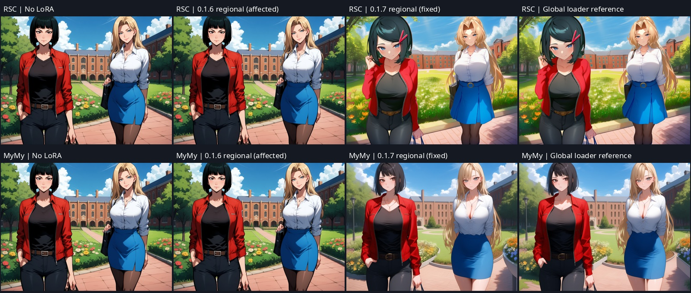

# 0.1.7 Zeta Fix

Fixes Anima regional LoRAs silently missing the model used for generation with
ComfyUI's default dynamic VRAM. Update and restart ComfyUI. Existing character
LoRA selections, strengths and saved workflows remain usable.

## Cause and correction

When conditioning hooks are present, ComfyUI can replace `ModelPatcherDynamic`
with a non-dynamic delegate after LoRA preparation. That delegate owns different
layer objects. Version 0.1.6 injected the bypass into the preparation-time layers,
so wrapper counters and metadata could look correct while inference ran without
the LoRA. In the reproduced case, assigning the same LoRA to both characters
produced a pixel-identical copy of the no-LoRA image; a standard global loader
produced a visibly different image.

The bypass now resolves its saved layer paths against `executor.class_obj`, the
diffusion model actually being evaluated. Shapes are checked before injection.
Its temporary forwards are restored on the actual runtime layers, including errors.
Small factor sharing, per-character prediction masks and fallback weight hooks are
retained. There is no new full-weight cache or user setting.

## Controlled image validation

Anima Aesthetic v1.1, two adult characters, 1024×768, seed 250917, 30 steps,
CFG 4, Euler ancestral / SGM uniform. Regional model strength 1.0, CLIP strength
0.0; RSC and MyMy ordinary rank-32 LoRAs, 280 layers per file. ComfyUI commit
`5cc4b870094c89090db54bd8d12649dcaf89f2ba`, default dynamic VRAM, RTX 5060 Ti.
Each condition uses the same prompt, coordinates and seed. This is a functional
comparison at one seed, not a general identity or image-quality benchmark.

| Comparison | Mean absolute RGB difference, out of 255 | Result |
|---|---:|---|
| 0.1.6, RSC on both characters vs no LoRA | 0.0000 | Bug reproduced |
| 0.1.6, MyMy on both characters vs no LoRA | 0.0000 | Bug reproduced |
| Fixed RSC on both characters vs global RSC loader | 4.9606 | Similar visible style; different floating-point calculation order |
| Fixed MyMy on both characters vs global MyMy loader | 5.1419 | Similar visible style; different floating-point calculation order |
| Fixed RSC/MyMy vs native weight-hook RSC/MyMy | 4.5915 | Both apply LoRAs; small-factor execution retained |
| Fixed RSC/MyMy vs swapped MyMy/RSC | 39.6932 | Assignment changes the generated result |

Actual adapter execution is instrumented, rather than only counting wrapper entry:
the fixed two-LoRA run calls the adapters 16,800 times (280 layers × 30 evaluations
× two LoRAs). It makes zero weight-synthesis calls. One paired observation measured
158.36 seconds with native weight hooks and 66.32 seconds with corrected bypass,
including sampler encoding and VAE decode. These are local single-run measurements.

Zero strengths and a later no-LoRA run both matched the baseline pixel for pixel.
The detailer corrected both detected faces with their respective LoRAs; its result
differs from native weight hooks by mean RGB 0.0457/255 across the full image.
The mixed layout also completed with two character LoRAs and a separate, legible
`CAMPUS` text box. All fixed bypass runs restored runtime forwards and released
device factor copies. The accompanying [machine-readable evidence](zeta-fix-evidence.json)
records completed cases, numerical comparisons and cleanup checks.

The CPU regressions exercise an actual ComfyUI `WrapperExecutor` with a different
inference module from the preparation module, compare against merged FP32 weights,
and verify zero strength plus restoration after failure. Current-core suite:
108 tests passed. All four JavaScript test suites passed.

## Scope and previous evidence

The completed image comparison covers the ordinary Anima LoRA bypass that was
affected. Other families continue using the existing weight-hook path. This release
does not add or claim new Krea2, MOSS or SD1.5 regional-LoRA image validation.
Regions can still influence each other indirectly; a successful LoRA application
does not guarantee exact character identity or perfectly isolated style.

The [0.1.6 bypass report](regional-lora-bypass-validation.md) is corrected at its
top: its controlled performance runs disabled dynamic VRAM, while its default-mode
check proved completion only. Saved filenames and successful wrapper invocation
were insufficient evidence of effect in the default mode.

## 한국어

ComfyUI가 샘플링 직전에 모델 인스턴스를 바꾸면 캐릭터 LoRA가 이전 모델에만
적용되던 오류를 수정했습니다. 실제 생성 모델에 작은 LoRA 행렬을 적용하며,
기존의 메모리 절약 방식은 유지합니다. 업데이트 후 ComfyUI를 재시작하세요.
기존 LoRA 선택과 강도는 그대로 쓸 수 있습니다. 모든 캐릭터에 같은 LoRA를
지정한 결과를 전역 LoRA 로더와 비교해 실제 효과를 확인했습니다.

## 日本語

ComfyUI がサンプリング直前にモデルを置き換えると、キャラクター LoRA が
古いインスタンスだけに適用される不具合を修正しました。実際の生成モデルに
小さい行列を適用し、従来のメモリ節約方式を維持します。更新後に ComfyUI を
再起動してください。既存の LoRA 選択と強度はそのまま使用できます。
