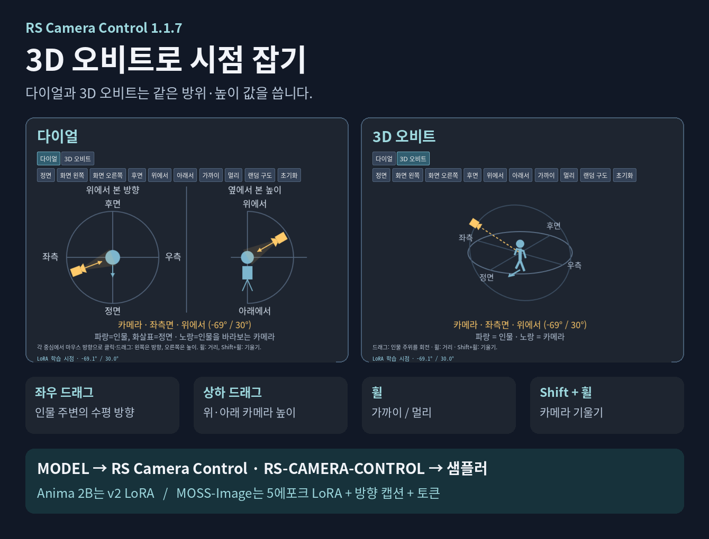
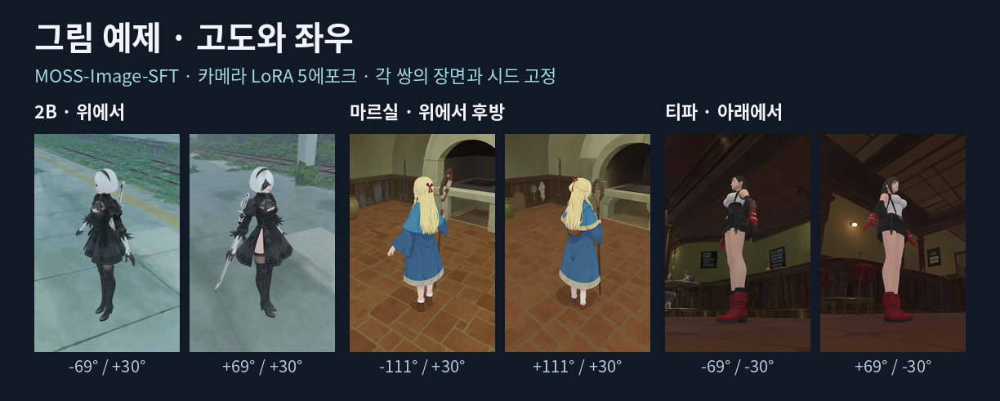
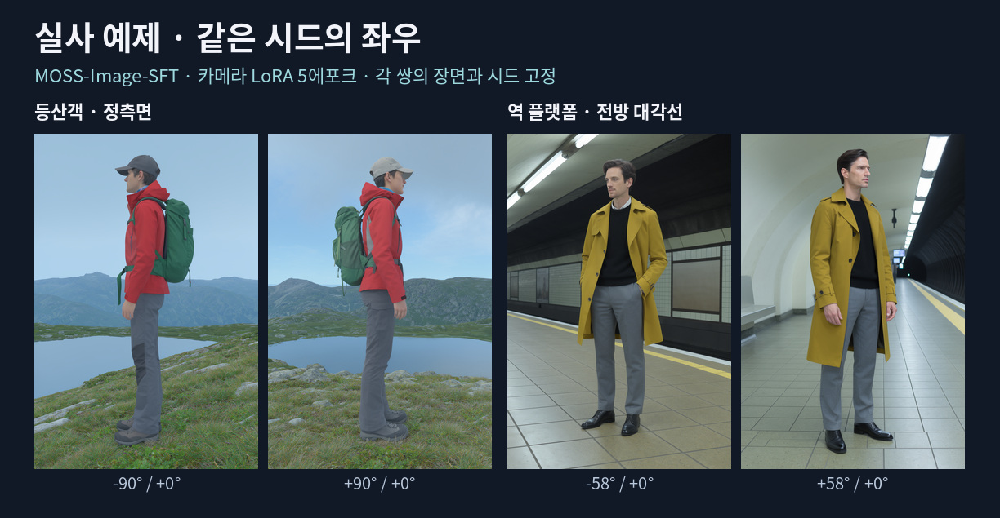

# 1.1.7 Hangeul — 3D Orbit and MOSS camera control

**RS Camera Control · RS-CAMERA-CONTROL** now selects its adapter from the
connected MODEL. Anima 2B uses RS-CAMERA-CONTROL-v2. MOSS-Image uses the
epoch-5 LoRA, direction caption, and the learned token for the nearest of
42 training viewpoints. Uncached weights download from Hugging Face on the
first queued run with the camera and LoRA enabled. MOSS requires a ComfyUI
build that supports the `moss_image` text encoder.

The **3D Orbit** tab shares the same values as **Dials**. Drag horizontally
for direction or vertically for elevation. Scroll for distance and
Shift-scroll for roll. The blue figure shows the subject and its forward
direction. The yellow marker shows the camera. The editor mode is saved
with the workflow.

## 한국어 그림 가이드

1. ComfyUI Manager에서 **RS MultiCharacter Sampler (Hangeul)**를 1.1.7로
   업데이트하고 ComfyUI를 재시작한 뒤 브라우저를 새로고침합니다.
2. **RS Camera Control · RS-CAMERA-CONTROL**의 `model` 입력에 모델을,
   `base_prompt`에 장면 프롬프트를 연결합니다. 카메라의 `model` 출력을 샘플러에
   연결합니다. 일반 KSampler는 카메라의 `prompt` 출력을 **양성 CLIP Text
   Encode**의 `text`에 연결합니다. MOSS는 `moss_image` 타입의 인코더를 씁니다.
   RS 샘플러에서는 카메라 MODEL과 Finalize를 거친 캐릭터 파이프를 연결합니다.
3. **3D 오비트**를 누르고 드래그해 방향과 높이를 잡습니다. 휠은 거리,
   Shift+휠은 기울기입니다. **화면 왼쪽**과 **화면 오른쪽** 프리셋은 인물이
   결과 화면에서 바라볼 방향입니다. 카메라 아래에 가장 가까운 LoRA 학습 각도가
   표시됩니다. 처음에는 `lora_strength=1.0`에서 실행해 보세요.

후면·뒤 대각선에서는 눈 색, 표정과 시선처럼 단독으로 적힌 태그를 자동으로
거릅니다. 와일드카드는 카메라 앞에서 펼치면 필터에 들어갑니다. 오비트에서
연속적으로 움직여도 가중치가 학습한 방향은 42개입니다. 생성 결과의 실제
각도와 기울기, 인물의 좌우는 프롬프트와 시드의 영향도 받습니다.

- [Anima 2B 예제 워크플로](../examples/camera/anima-camera-control.json)
- [MOSS LoRA 및 카메라 토큰](https://huggingface.co/raspie/RS-CAMERA-CONTROL-MOSS)
- [Anima v2 LoRA](https://huggingface.co/raspie/RS-CAMERA-CONTROL)
- [카메라 노드 연결과 설정](camera-control.md)

## MOSS 생성 예제

Each mirrored pair shares a scene and seed. These examples use MOSS-Image-SFT
at 768 × 1152, Euler ancestral CFG++, SGM Uniform, 20 steps, and CFG 3,
with no acceleration LoRA. In the full 16-view comparison, automated scoring
found both sides correct for seven out of seven pairs, and three pairs also
met the tighter angle criterion. The held scenes and seeds define the scope
of that comparison. Separately, three native KSampler runs matched manual
LoRA, caption and token wiring pixel for pixel across an RTX 5060 Ti and
RTX 4070 Ti SUPER.
